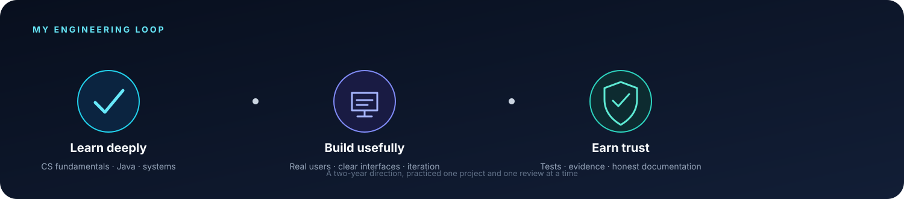
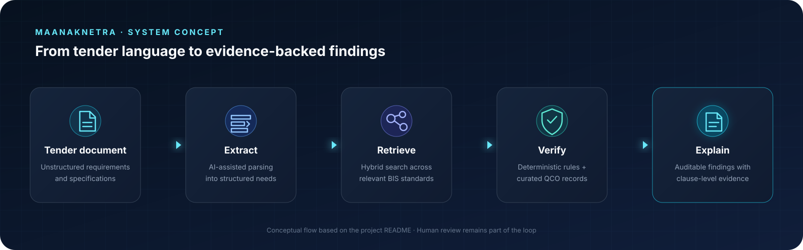

# Ragasri G
### ASPIRING SOFTWARE DEVELOPMENT ENGINEER · BACKEND · APPLIED AI

**I build to understand how systems work—and how to make their answers trustworthy.**

---

## A little about how I think

I’m an aspiring **Software Development Engineer** interested in backend engineering and practical AI. I’m drawn to problems where software has to do more than produce an answer: it should handle details carefully, show its evidence, and make it possible for a person to check the result.

That idea is shaping my current work—from learning **Java 17 and Spring Boot** through the JPMC Forage Midas project to exploring **Python, FastAPI, and retrieval systems** in MaanakNetra.

## Project spotlight

### 🛡️ MaanakNetra
**Procurement compliance, grounded in traceable evidence**  
[Open the project on GitHub →](https://github.com/ragasri-ict/MaanakNetra)

MaanakNetra is a **Smart India Hackathon 2026 project (SIH26108)** exploring how procurement teams can compare tender requirements with Indian Standards and Quality Control Orders. The system concept combines AI-assisted reading of tender language with structured standards data and deterministic checks.

**What interests me about the design:** AI can help interpret documents, but compliance findings need to be grounded in verified records and traceable to a standard, clause, or rule. Human review stays in the loop.

<b>Project stack and structure</b>

 

- **Frontend:** React · TypeScript · Tailwind CSS
- **Backend:** FastAPI
- **Retrieval described in the repository:** BGE-M3 · BM25 · cross-encoder reranking
- **Project areas:** frontend · backend · AI · contracts · curated data · tests · demo · docs

[Browse the repository and its documentation →](https://github.com/ragasri-ict/MaanakNetra)

## Other things I’m building and learning from

<table>
<tr>
<td width="50%" valign="top">
<h3>☕ Midas Core · JPMC Forage</h3>

Hands-on practice in the JPMC Advanced Software Engineering Forage program. This repository is a fork of the program project; it’s listed here as learning work, with attribution to the <a href="https://github.com/vagabond-systems/forage-midas">original repository</a>.

<code>Java 17</code> <code>Spring Boot 3</code> <code>Maven</code>

<a href="https://github.com/ragasri-ict/forage-midas">View repository →</a>
</td>
<td width="50%" valign="top">
<h3>📊 VishwaDrishti AI</h3>

An early dashboard concept for exploring India's development indicators. The current repository uses React and Vite; its project documentation is still being developed.

<code>React</code> <code>Vite</code>

<a href="https://github.com/ragasri-ict/VishwaDrishti-AI">View repository →</a>
</td>
</tr>
<tr>
<td width="50%" valign="top">
<h3>📈 TradeGuard AI</h3>

An in-progress project repository organized around backend, data, frontend, and tests. I’m continuing to develop its project description and setup guide.

<code>Python</code> <code>JavaScript</code>

<a href="https://github.com/ragasri-ict/tradeguard-ai">View repository →</a>
</td>
<td width="50%" valign="top">
<h3>🧪 Small builds</h3>

Smaller web projects and experiments that help me practice shipping and polishing ideas.

<a href="https://github.com/ragasri-ict/notes-app">Notes App</a> · <a href="https://github.com/ragasri-ict/portfolio">Portfolio</a>

</td>
</tr>
</table>

## My current toolkit

## Where I’m headed

**Over the next two years**, I’m focused on strengthening computer science fundamentals, building and deploying complete applications, learning from code review, and contributing to shared codebases. I’m open to **internships, project feedback, and beginner-friendly open-source work**.

[LinkedIn](https://www.linkedin.com/in/ragasri-g2006/) &nbsp;·&nbsp; [Email](mailto:ragasrig.ict@gmail.com) &nbsp;·&nbsp; [All repositories](https://github.com/ragasri-ict?tab=repositories)

Curious by default. Careful with evidence. Better with every build.

